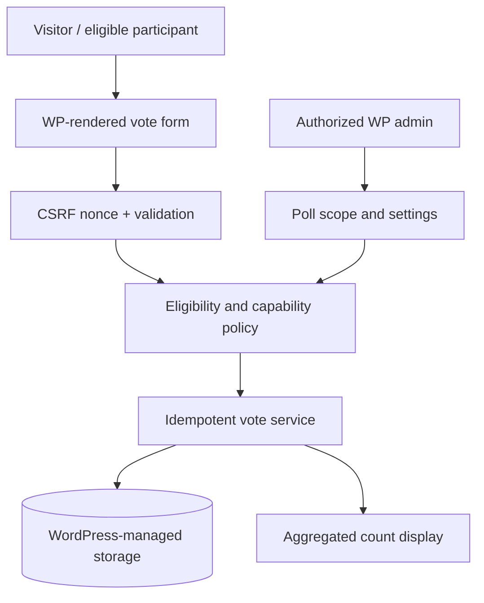

# WP Pro Votes — WordPress Voting Plugin Design Considerations — Reference Architecture

## What is known

The repository title/description identifies a WordPress voting-plugin project. There is no public WordPress plugin PHP entry point, packaged distribution or installable source here.

## Engineering question

Voting systems must clearly specify eligibility, replay prevention, vote counting and administrative access, even when the front-end UX appears straightforward.

## Illustrative flow (not a production diagram)

## Design invariants and risk controls

- WordPress nonces are anti-CSRF controls, not authorization or proof of voter eligibility.
- Server-side eligibility rules and rate limits must be explicit; IP-only uniqueness can exclude shared-network users.
- Enforce prepared queries, output escaping, capability checks and authenticated administration.
- Define how duplicate votes, editing, poll closure and auditability work before exposing aggregated counts.

## Synthetic scenario to test in future

Synthetic poll: multiple submissions from the same fictional eligible account, then one from an unauthorized account; expect exactly one counted ballot and one denial without exposing identity in results.

## Failure mode / trade-off

Claiming votes are unique without a documented eligibility identifier leads to unreliable counts.

## Evidence required before confirming features

- A versioned implementation artifact or test contract, reviewed against original source.
- A deterministic fixture that exercises negative permissions, errors and recovery.
- A dated CI run linked to the fixture rather than to documentation formatting alone.
- Authorized sanitized images/measurements; never actual account or customer data.

This file should be updated when real evidence becomes publishable; until then these are **design notes only**. See [README.md](README.md) and [ROADMAP.md](ROADMAP.md).
